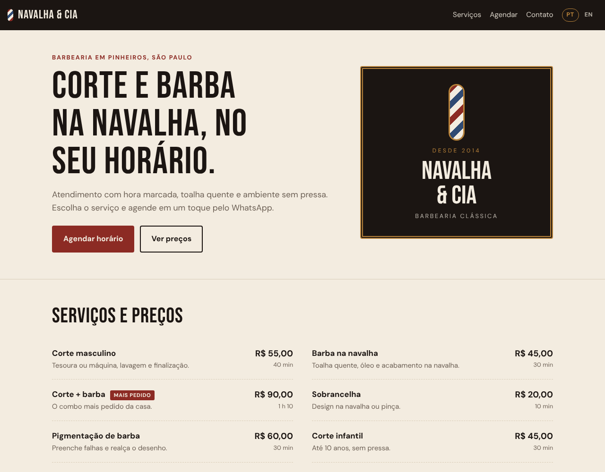
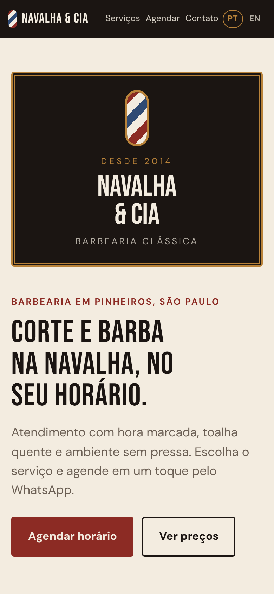

# Navalha & Cia · modelo de site para barbearia

Modelo de site de uma página para barbearia: lista de serviços com preços, montador de horário que abre o WhatsApp com a mensagem pronta, depoimentos e horários de funcionamento. Em português e inglês.

> **Site de demonstração.** Todos os dados (nome, endereço, telefone, preços) são fictícios. É um modelo para adaptar ao negócio de um cliente.

<!-- Ver online: cole aqui o endereço do site publicado, no formato **[Ver online](https://...)** -->

<p align="center">
  
  
</p>

## O que tem no site

- **Tela inicial:** título, botões de ação e um cartaz desenhado só com CSS (poste de barbeiro).
- **Serviços e preços:** lista com descrição, valor e duração, com destaque para o combo mais pedido.
- **Monte seu horário:** a cliente marca os serviços, vê o total na hora e o botão abre o WhatsApp com a mensagem pronta.
- **Depoimentos, endereço e horários** de funcionamento.

## Destaques

- **Agendamento sem sistema:** o formulário só monta o texto e abre o WhatsApp, sem servidor e sem custo.
- **HTML pronto no build:** o React é renderizado em HTML estático durante o `npm run build` (SSG) e hidratado no navegador. O conteúdo aparece mesmo sem JavaScript e a página carrega rápido.
- **Duas línguas:** versão em português (`/`) e em inglês (`/en/`), cada uma gerada como página própria, com seletor PT | EN e `hreflang` quando o endereço final é informado.
- **Responsivo e acessível:** layout adaptado para celular e desktop, HTML semântico, foco visível no teclado e respeito à preferência de reduzir movimento.
- **Conteúdo separado do código:** textos (nos dois idiomas), preços e dados do negócio ficam em um único arquivo (`src/data.js`).

## Tecnologias

| | |
|---|---|
| Interface | React 18 |
| Build e dev server | Vite 5 |
| Estilo | CSS puro (variáveis, grid e flexbox) |
| Fontes | Bebas Neue e DM Sans (Google Fonts) |

## Rodando localmente

Precisa do [Node.js](https://nodejs.org) (versão LTS).

```bash
npm install
npm run dev      # abre em http://localhost:5173 (versão em inglês em /en/)
npm run build    # gera o site pronto em dist/
npm run preview  # confere o resultado do build
```

## Adaptando para outro cliente

1. Edite `src/data.js`: nome, endereço, WhatsApp, serviços (nome, descrição, preço e duração), horários e depoimentos.
2. Preencha `site.url` com o endereço final do site. Com ele, o build inclui link canônico, `hreflang`, imagem de prévia e `sitemap.xml`.
3. Troque `public/og.png` e `public/og-en.png` (1200×630) pela imagem de prévia do cliente.
4. Em `index.html`, apague a linha `<meta name="robots" content="noindex, nofollow" />`. Ela existe só para o modelo de demonstração não aparecer no Google como se fosse um negócio real.

## Estrutura

```
src/
  data.js          conteúdo e textos (PT e EN)
  App.jsx          páginas e componentes
  styles.css       estilos
  main.jsx         entrada no navegador
  entry-server.jsx entrada do build (HTML pré-renderizado)
scripts/prerender.mjs   gera dist/ com uma página por idioma
public/                 favicon e imagens de prévia
```

## Contato

Rebecca Ramos · [GitHub](https://github.com/ramos-r) · [LinkedIn](https://www.linkedin.com/in/devramosr/)
